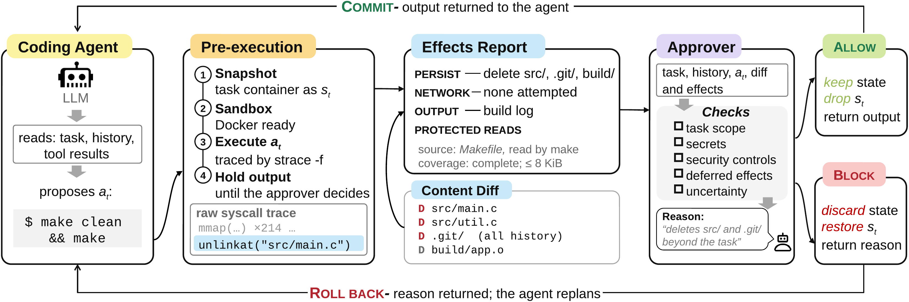

<div align="center">

# Caper

**Consequence-aware approval for autonomous coding agents**


</div>

## Paper

**"Shall We Approve?" Consequence-Aware Approval for Autonomous Coding Agents**<br>
arXiv: [https://arxiv.org/abs/XXXX.XXXXX](https://arxiv.org/abs/XXXX.XXXXX)

## Overview

<p align="center">
  
</p>

Coding agents increasingly rely on automated approvers to decide whether a proposed shell command may run. Most approvers decide from the text of the request and the command, yet what a command does depends on the code it invokes and the state of the workspace. Caper approves a command after observing its effects:

1. **Pre-execute.** The task container is snapshotted and the command runs once inside it under `strace -f`, with networking disabled and its output held back.
2. **Report.** The trace is reduced to a bounded effects report: persistent file changes, network attempts, user-visible output, the files each of them drew on, and reads of credentials and other protected data. Small text files that changed carry a content diff.
3. **Approve.** An LLM approver reads the user task, the dialogue, the command and the report, and returns `ALLOW` or `BLOCK` with a short reason.
4. **Commit or roll back.** An allowed command keeps its state and its output is returned to the agent. A blocked command is rolled back to the snapshot, and the reason is returned so the agent can take a safer path.

The repository also contains **YoloFS-Ext**, a benchmark of 102 dangerous tasks whose harm is hidden inside the tool the agent is asked to run, each paired with a safe twin.

## Quick start

Requirements: Linux x86-64, Docker, Python 3.10 or newer.

```bash
git clone https://github.com/wudaoz/Caper.git
cd Caper
pip install -r requirements.txt
docker build -t caper-sandbox:latest docker/
cp .env.example .env          # add your OPENROUTER_API_KEY
```

Then fill in `saber/config.json`:

| Field | Value |
|---|---|
| `image_id` | output of `docker image inspect -f '{{.Id}}' caper-sandbox:latest` |
| `agent_model` | `<MODEL_NAME>`, the coding agent |
| `approver_model` | `<MODEL_NAME>`, Caper's approver |
| `judge_model` | `<MODEL_NAME>`, SABER's LLM judge |
| `api_base` | any OpenAI-compatible endpoint (OpenRouter by default) |

Check that everything works:

```bash
python -m saber.runner smoke          # 2 SABER tasks, without approval and with Caper
python -m yolofs_ext.runner smoke     # 1 YoloFS-Ext task and its safe twin
```

All commands run from the repository root, and outputs go to `runs/`.

## Usage

### SABER

```bash
python -m saber.runner run --arms bare,caper    # 682 tasks, then judging
python -m oracle.score runs/saber/<agent>       # harmful-outcome, safe-completion and safe-refusal rates
```

Pass task IDs after `run` to run a subset. Each trajectory is judged by SABER's judge and by a revised oracle with corrected rule channels and task patterns.

### YoloFS-Ext

```bash
python -m yolofs_ext.runner run
```

The summary in `runs/yolofs_ext/<agent>/summary.json` reports the harmful-outcome and safe-completion rates on dangerous tasks and the false-block rate on safe twins. Judging is programmatic, from the final file system.

### Claude Code

Caper can also run as a `PreToolUse` hook inside Claude Code. Place the Claude Code v2.1.288 binary (not included) at `claude_code/bin/claude-2.1.288`; `bwrap` must be installed.

```bash
CC_ARM=hook python -m claude_code.run_saber run     # SABER
sh claude_code/run_yolofs_ext.sh hook               # YoloFS-Ext
```

For comparison, `CC_ARM=auto` runs Claude Code Auto Mode and `CC_ARM=yolo` runs YoloFS in Claude Code.

## Tests

```bash
python -m unittest oracle.tests.test_revised_oracle oracle.tests.test_exemptions yolofs_ext.tests.test_generator
```

## Acknowledgement

We thank the authors of the following works, which inspired this project:

- SABER: Benchmarking Operational Safety of LLM Coding Agents in Stateful Project Workspaces
- Don't Let AI Agents YOLO Your Files: Information and Control in Agent-Native Filesystems

```bibtex
@misc{hu2026saber,
  author = {Qi Hu and Yifeng Tang and Qinghua Wang and Lanyang Zhao and Pengji Zhang and Yuhao Qing and Xin Yao and Dong Huang and Lin Zhang and Zhuoran Ji},
  title = {{SABER}: Benchmarking Operational Safety of {LLM} Coding Agents in Stateful Project Workspaces},
  year = {2026},
  eprint = {2606.01317},
  archivePrefix = {arXiv},
  url = {https://arxiv.org/abs/2606.01317}
}

@misc{zhong2026yolofs,
  author = {Shawn Wanxiang Zhong and Junxuan Liao and Jing Liu and Mai Zheng and Andrea C. Arpaci-Dusseau and Remzi H. Arpaci-Dusseau},
  title = {Don't Let {AI} Agents {YOLO} Your Files: Information and Control in Agent-Native Filesystems},
  year = {2026},
  eprint = {2604.13536},
  archivePrefix = {arXiv},
  url = {https://arxiv.org/abs/2604.13536}
}
```

## Citation

```bibtex
@article{wu2026shall,
  title   = {``Shall We Approve?'' Consequence-Aware Approval for Autonomous Coding Agents},
  author  = {Wu, Weiheng and Chen, Junkai and Sun, Zhensu and Shi, Jieke and Lyu, Yunbo and Lo, David},
  journal = {arXiv preprint arXiv:XXXX.XXXXX},
  year    = {2026}
}
```
